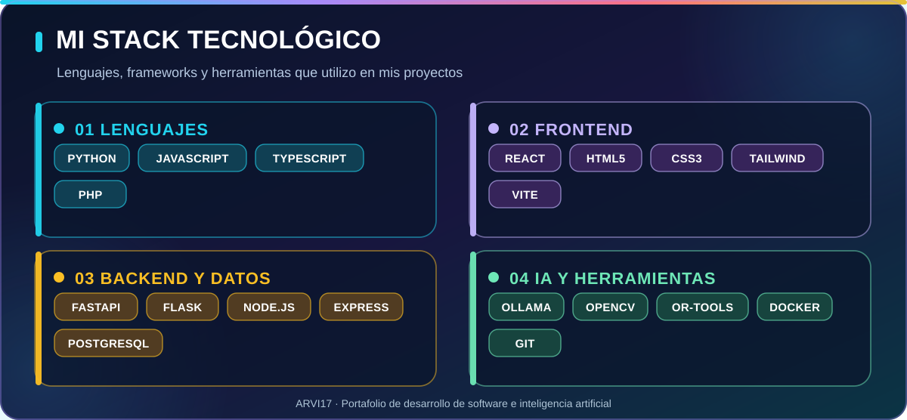

### 👨‍💻 Armando E. Vives Fuentes · ARVI17

**Desarrollo de software · Aplicaciones web · Inteligencia artificial aplicada · Automatización**

Diseño y desarrollo aplicaciones, APIs, asistentes inteligentes y herramientas digitales para resolver necesidades reales.

---

## ⚡ Mi perfil en 10 segundos

| | |
|:---|:---|
| **💻 Qué desarrollo** | Aplicaciones web, APIs, sistemas de gestión y experiencias conversacionales. |
| **🧠 Qué me interesa** | Inteligencia artificial local, optimización, automatización y análisis de datos. |
| **🏗️ Cómo trabajo** | Interfaces + backend + bases de datos + contenedores, con documentación de los proyectos. |
| **🚀 Qué encontrarás aquí** | Proyectos educativos, financieros, deportivos y utilidades de software. |

## 📊 Mi GitHub en números

**🔍 [Ver actividad reciente y contribuciones](https://github.com/ARVI17?tab=overview)** · **🌐 [Explorar el código de mi portafolio interactivo](docs/)**

> Las cifras de seguidores y estrellas se consultan a través de insignias dinámicas. El total de repositorios es una instantánea del **27 de octubre de 2026**. El portafolio web incluye estadísticas públicas actualizadas al visitarlo, cuando se active GitHub Pages.

## 🛠️ Lenguajes de programación y tecnologías

  

**🔷 Lenguajes de programación**

**💜 Frontend e interfaces**

**🟡 Backend y bases de datos**

**🟢 Inteligencia artificial, optimización y herramientas**

Estas tecnologías se muestran por su presencia en mis repositorios y proyectos. No representan certificaciones ni un nivel de dominio específico.

## 💡 En qué aplico estas tecnologías

- **Web Full Stack:** React, TypeScript, FastAPI, Flask, Express y PostgreSQL para interfaces y APIs.
- **IA y automatización:** Ollama, visión por computador y optimización de soluciones en un entorno local.
- **Educación digital:** asistentes de consulta institucional y herramientas de evaluaciones académicas.
- **Analítica:** viabilidad financiera y experimentación con modelos de predicción deportiva.

## ✨ Proyectos destacados

<table>
<tr>
<td width="50%" valign="top">
  
  <h3>⚽ FC Club Lab</h3>
  
Asistente local de inventario y optimización DCP/SBC con FastAPI, React, PostgreSQL y Ollama. <strong>Proyecto no oficial en desarrollo.</strong>

  <a href="https://github.com/ARVI17/emuladordcp26">Ver código y documentación</a>
</td>
<td width="50%" valign="top">
  
  <h3>🏫 Asistente Palominito</h3>
  
Orientación educativa mediante consultas conversacionales locales basadas en documentos institucionales.

  <a href="https://github.com/ARVI17/Asistente_Palominito_v4_Conversacional">Explorar proyecto</a>
</td>
</tr>
<tr>
<td width="50%" valign="top">
  
  <h3>📊 Finance Lab</h3>
  
Simulador para proyecciones a cinco años, evaluación de indicadores y análisis de escenarios.

  <a href="https://github.com/ARVI17/Herramienta-de-viabilidad-financiera-vers4.0">Explorar proyecto</a>
</td>
<td width="50%" valign="top">
  <h3>🤖 Machine Learning deportivo</h3>
  
Proyecto de predicción de resultados de fútbol (victoria/empate/derrota). <strong>Plan de desarrollo y aprendizaje.</strong>

  
📚 Pipeline de datos · Entrenamiento · API · Docker

  <a href="https://github.com/ARVI17/Modelo-de-Machine-Learning-para-predecir-el-resultado-de-un-partido-de-f-tbol-win-draw-loss-">Ver hoja de ruta</a>
</td>
</tr>
</table>

## 🧭 Más proyectos

- 📅 [CitaMatic — Gestión de citas y SMS](https://github.com/ARVI17/KIBA)
- 📘 [Plataforma de evaluaciones académicas y gestión documental](https://github.com/ARVI17/examen)
- 🧩 [Utilidad de combinación de PDF con Java/MVC](https://github.com/ARVI17/PDFMergerAppMVC) — prototipo

---

### 🚀 Crear, aprender, documentar y mejorar

Portafolio público de ARVI17 · Actualiza las secciones conforme evolucionen los proyectos.

