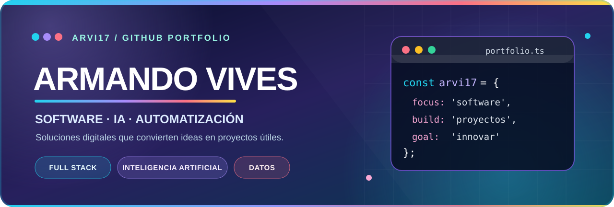

### 👋 ¡Bienvenido a mi espacio de desarrollo!

**Diseño soluciones digitales para gestión, educación, analítica y automatización.**

---

## 🌈 Sobre mí

Desarrollo y documento proyectos tecnológicos aplicados a problemas reales: desde **sistemas web de gestión y herramientas financieras** hasta **asistentes locales e inteligencia artificial**. Me interesa transformar ideas complejas en interfaces útiles y fáciles de utilizar.

- ⚽ **Automatización y optimización:** experimentos de inventario, plantillas y desafíos DCP/SBC.
- 🏫 **Tecnología educativa:** asistentes de orientación y plataformas académicas.
- 📊 **Análisis de datos:** simuladores financieros y proyectos de *machine learning*.
- 🧩 **Arquitectura de software:** APIs, bases de datos, contenedores e interfaces web.

## 💻 Tecnologías utilizadas en mis proyectos

## ✨ Proyectos destacados

<table>
<tr>
<td width="50%" valign="top">
  
  <h3>⚽ FC Club Lab</h3>
  
Asistente local de inventario y optimización DCP/SBC con FastAPI, React, PostgreSQL y Ollama. <strong>Proyecto no oficial en desarrollo.</strong>

  <a href="https://github.com/ARVI17/emuladordcp26">Ver código y documentación</a>
</td>
<td width="50%" valign="top">
  
  <h3>🏫 Asistente Palominito</h3>
  
Orientación educativa mediante consultas conversacionales locales basadas en documentos institucionales.

  <a href="https://github.com/ARVI17/Asistente_Palominito_v4_Conversacional">Explorar proyecto</a>
</td>
</tr>
<tr>
<td width="50%" valign="top">
  
  <h3>📊 Finance Lab</h3>
  
Simulador para proyecciones a cinco años, evaluación de indicadores y análisis de escenarios.

  <a href="https://github.com/ARVI17/Herramienta-de-viabilidad-financiera-vers4.0">Explorar proyecto</a>
</td>
<td width="50%" valign="top">
  <h3>🤖 Machine Learning deportivo</h3>
  
Proyecto de predicción de resultados de fútbol (victoria/empate/derrota). <strong>Plan de desarrollo y aprendizaje.</strong>

  
📚 Pipeline de datos · Entrenamiento · API · Docker

  <a href="https://github.com/ARVI17/Modelo-de-Machine-Learning-para-predecir-el-resultado-de-un-partido-de-f-tbol-win-draw-loss-">Ver hoja de ruta</a>
</td>
</tr>
</table>

## 🧭 Más proyectos

- 📅 [CitaMatic — Gestión de citas y SMS](https://github.com/ARVI17/KIBA)
- 📘 [Plataforma de evaluaciones académicas y gestión documental](https://github.com/ARVI17/examen)
- 🧩 [Utilidad de combinación de PDF con Java/MVC](https://github.com/ARVI17/PDFMergerAppMVC) — prototipo

---

### 🚀 Crear, aprender, documentar y mejorar

Portafolio público de ARVI17 · Actualiza las secciones conforme evolucionen los proyectos.

